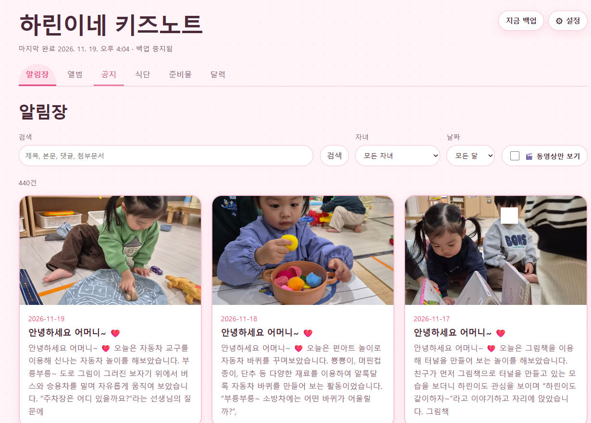

# Kidsnote HA Backup

키즈노트의 **알림장·앨범·공지·식단·일정표·투약의뢰서·귀가동의서·체온기록**과 첨부 파일(사진·영상·PDF·HWP·DOCX 등)을 **Home Assistant OS** 기기의 로컬 저장소로 자동 백업하고, Home Assistant 안의 웹 UI에서 바로 열람·검색할 수 있는 커뮤니티 앱입니다.

[](https://my.home-assistant.io/redirect/supervisor_add_addon_repository/?repository_url=https%3A%2F%2Fgithub.com%2Fredchupa%2Fkidsnote-ha-backup)

[화면 예시](#화면-예시) · [주요 기능](#주요-기능) · [설치 및 사용 방법](#설치-및-사용-방법) · [자주 묻는 질문](#자주-묻는-질문) · [후원하기](#후원)

## 화면 예시



## 주요 기능

* **8종 통합 로컬 백업**: 알림장(생활기록·댓글·첨부 포함), 앨범, 공지사항, 식단, 일정표, 투약의뢰서, 귀가동의서, 체온기록을 기기에 안전하게 보관합니다.
* **첫 알림장 기준 스마트 수집**: 공지·식단·일정표·투약·귀가·체온은 자녀의 **첫 알림장 날짜 이후** 기록만 선별해 불필요한 과거 기관 데이터를 줄입니다.
* **7종 테마 & ⚙ 보관함 설정**: `시스템 자동 · 화이트 · 블랙 · 블루 · 아이보리 · 귀여운 컨셉 · 미래지향적` 테마, **보관함 이름 변경**, **기본 시작 화면**을 설정할 수 있으며 모든 기기에 자동 동기화됩니다.
* **달력 통합 뷰 & 준비물 체크리스트**: 달력에서 날짜를 누르면 해당 날짜의 일정과 알림장·앨범·식단·공지·투약·귀가 기록을 한눈에 볼 수 있고, 알림장·공지·첨부문서에서 추출한 준비물에 **챙김 완료 체크**를 할 수 있습니다.
* **편리한 열람·검색**: 사진 인앱 라이트박스(키보드·스와이프), 게시물 첨부 전체 **ZIP 일괄 다운로드**, **🎬 동영상만 보기** 필터, 첨부 문서(PDF·HWP·HWPX·PPTX·DOCX) 본문 통합 검색, 인쇄/PDF 저장을 지원합니다.
* **자동 세션 갱신 & 중단 이어받기**: 일반 계정은 세션 쿠키가 자동 발급·갱신되며, 백업 도중 앱이 중단되어도 체크포인트(`checkpoint.json`)를 통해 누락 없이 중단 지점부터 이어받습니다.
* **수동 백업 & Home Assistant 알림 연동**: 초기 백업 완료 후 웹 UI 상단의 **지금 백업** 버튼으로 즉시 동기화할 수 있으며, 선택 옵션(`notify_ha`)을 켜면 새 기록 백업 시 HA 이벤트(`kidsnote_backup_completed`)를 전송합니다.

## 설치 및 사용 방법

### 1. 저장소 추가 및 앱 설치
1. 위 **Home Assistant에 저장소 추가** 버튼을 누르거나, Home Assistant의 **설정 → 앱 → 앱 설치 → ⋮ → 저장소**에서 `https://github.com/redchupa/kidsnote-ha-backup`을 추가합니다.
2. **Kidsnote HA Backup**을 설치합니다. (지원 아키텍처: `amd64`, `aarch64`)

> 이미 예전 이름(`Kidsnote Local Backup`)으로 설치해 사용 중이라면, 기존 저장소를 그대로 두고 업데이트하세요. 새 저장소로 재설치하면 앱 ID가 달라집니다.

### 2. 구성 설정 (필수 항목만 입력하면 바로 시작!)
앱의 **구성** 탭에서 아래 항목을 설정한 뒤 **저장**합니다.

* **`[필수]` 키즈노트 아이디 / 비밀번호**: 일반 키즈노트 계정은 아이디와 비밀번호만 입력하면 세션 쿠키가 **자동으로 발급·갱신**됩니다.
* **`[선택]` 백업할 자녀 ID**: 비워두면 계정에 연결된 **모든 자녀**를 백업합니다. 특정 자녀만 선택하려면 PC 브라우저에서 키즈노트에 로그인한 뒤 새 탭에서 `https://www.kidsnote.com/api/v1/me/children/`을 열어 자녀 이름(`name`)과 같은 깊이의 `id` 숫자만 입력하세요.
* **2단계 인증 / 소셜 로그인 계정**: 아이디·비밀번호 칸을 비워두고, 구성 화면 하단의 **사용하지 않는 선택적 구성 옵션 표시**를 켠 뒤 `session_cookie`를 입력합니다. 자세한 쿠키 복사 방법은 [설치 및 사용 안내](kidsnote_backup/DOCS.md)를 참고하세요.

### 3. 앱 시작 및 보관함 열기
1. 앱을 시작하면 **첫 설치 시 5~30초 이내**에 첫 백업이 자동으로 시작됩니다.
2. 진행 상황은 **로그** 탭이나 **웹 UI 열기** 상단 상태바에서 실시간으로 확인할 수 있습니다.
3. 첫 백업이 끝나면 이후 기본 **24시간(+0~30분 무작위 분산)** 간격으로 자동 반복되며, 웹 UI 상단의 **지금 백업** 버튼도 활성화됩니다.

## 자주 묻는 질문

* **Q. 첫 백업은 얼마나 걸리나요?**
  * 키즈노트 서버 보호를 위해 요청 간격(API 1초 · 사진/영상 2초)을 두고 천천히 내려받습니다. 1~2년치 기록과 사진이 많다면 **약 2~5시간 이상** 걸릴 수 있으니 완료될 때까지 기다려 주세요. (완료 후 정기 백업은 새 기록만 받아 보통 1~3분 이내에 끝납니다.)
* **Q. 백업 중에 알림장만 보이고 앨범·공지·식단이 아직 안 떠요.**
  * 백업은 `알림장 → 앨범 → 투약·귀가·체온 → 공지 → 식단 → 일정표` 순으로 차례대로 진행됩니다. 웹 UI 상단 상태바나 **로그** 탭에서 현재 진행 중인 단계를 확인하실 수 있습니다.
* **Q. 첫 백업 도중에 앱을 중지하거나 HA가 재부팅되면 처음부터 다시 받나요?**
  * 아닙니다. 이미 저장된 단계와 기록을 체크포인트로 기억해 두므로, 다시 시작하면 약 5초 후 중단된 지점부터 누락 없이 이어받습니다.
* **Q. 일정표나 체온기록 탭이 비어 있어요.**
  * 이용 중인 어린이집·유치원에서 해당 메뉴를 사용하지 않거나 등록된 기록이 없는 경우 비어 있으며, 정상 동작입니다.

더 자세한 2단계 인증 설정, 백업 파일 저장 경로 및 복사 방법은 [설치 및 사용 안내](kidsnote_backup/DOCS.md)를 참고하세요. 이 앱은 Home Assistant 앱 스토어를 사용하는 Home Assistant OS용입니다.

## English

A community app for Home Assistant OS (`amd64` and `arm64`) that backs up Kidsnote **reports, comments, media, albums, notices, menus, schedules, medication requests, return-home consents, and temperature logs** to local storage and provides a built-in web archive viewer via Ingress.

* **Features**: 7 customizable themes & archive title settings (`⚙`), integrated daily calendar view, interactive supply checklist, photo lightbox, bulk ZIP attachment download, video-only filter, attached document (PDF/HWP/HWPX/PPTX/DOCX) search, resumable checkpointing after interruptions, manual backup trigger, and optional Home Assistant `kidsnote_backup_completed` event notifications.
* **Quick start**: Add this repository with the button above, install **Kidsnote HA Backup**, enter your Kidsnote username and password in **Configuration** (session cookies are issued and renewed automatically; for 2FA/social accounts, enable *Show unused optional configuration options* to enter `session_cookie`), and start the app.
* If you installed `Kidsnote Local Backup` before the rename, update from your existing repository to preserve your archive. See [setup and storage details](kidsnote_backup/DOCS.md#english).

## 후원

Kidsnote HA Backup이 가족의 추억을 보관하는 데 도움이 됐다면, 토스나 PayPal로 개발을 응원해 주세요.

<table>
  <tr>
    <td align="center">
      <strong>토스</strong><br>
      
    </td>
    <td align="center">
      <strong>PayPal</strong><br>
      
    </td>
  </tr>
</table>

**계좌이체** 토스뱅크 `1000-1261-7813` (우\*만)

Use the PayPal QR code above if you’d like to support the project from outside Korea.

## 개발

```bash
python -m pip install -r kidsnote_backup/requirements.txt
PYTHONPATH=kidsnote_backup python -m unittest discover -s tests -v
```

키즈노트 로그인, 준비물·일정 탐지와 문서 텍스트 추출 코드를 가져와 로컬 백업용으로 수정했습니다. [redchupa/kidsnote-backup](https://github.com/redchupa/kidsnote-backup)

## 라이선스 및 면책

Kidsnote HA Backup은 키즈노트나 Home Assistant와 공식 제휴하지 않은 독립 프로젝트입니다. 앱은 사용자의 Home Assistant 기기에서 키즈노트의 비공식 웹 API에 직접 요청하고, 백업 파일을 기기에 저장합니다. 키즈노트 서비스가 바뀌면 백업 기능에 영향이 생길 수 있습니다.

앱은 MIT 라이선스에 따라 **현 상태 그대로** 제공됩니다. 적용 법률이 허용하는 범위에서 개발자와 저작권자는 명시적·묵시적 보증을 제공하지 않으며, 앱 사용으로 발생한 데이터 손실, 서비스 중단 또는 기타 손해에 대해 책임을 지지 않습니다. 사용자는 키즈노트 이용약관과 데이터 접근 권한을 준수하고 백업 결과를 확인할 책임이 있습니다. [MIT 라이선스 원문](LICENSE)
